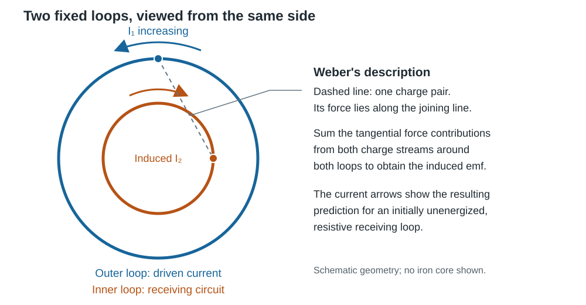

# From electrostatics to electromagnetic waves

How could experiments with charged objects, magnets and wires lead to the conclusion that **light is an electromagnetic wave**? To follow that development, keep three things separate: an observation, an explanation of it, and a prediction that has not yet been tested.

For example, consider three steps that we will encounter below:

- **Observation:** a compass needle turns when a nearby wire carries a current. Reversing the current reverses the deflection. These are things one can measure.
- **Explanation:** in the field description, the current produces a magnetic field, which exerts a torque on the compass needle. This gives a physical account of the observation; the deflection alone does not establish how the influence crosses the space between wire and compass.
- **Prediction:** Maxwell's theory implies that an electrical disturbance can travel through empty space as a wave. Before such waves had been detected, this suggested a new experiment: produce a disturbance electrically and look for its effect at a distant receiver.

The historical account follows Friedel's *Lines and Waves*, supplemented by records of the original apparatus and Maxwell's own paper. The equations are written in **modern notation** to connect the discoveries with the field equations used in this book. The original arguments developed in a different order and used different notation {cite}`friedel_lines_waves,longair_maxwell_2015`.

## A successful starting point: forces between objects

The {doc}`potential-field description <../2_potential_fields/introduction/potential>` relates a field to its sources and to a scalar potential. In electrostatics,

$$
\vec E=-\vec\nabla V,\qquad
\vec\nabla\cdot\vec E=\frac{\rho_q}{\epsilon_0}.
$$

The inverse-square force between stationary charges resembles Newtonian gravity. One could calculate forces directly between objects without assigning a physical role to the intervening space. This was a productive approach: success in predicting static forces did not, by itself, tell people how a **change** would reach another object.

For a concrete example, imagine two charged spheres held at a fixed distance. Coulomb's law gives the force between them. Now move one sphere closer: after everything has settled, the force is larger. But when does the force on the other sphere begin to change? Immediately when the first sphere moves, or only after an influence has travelled between them? The static force law gives the initial and final forces, but does not answer this timing question.

```{admonition} Connect to potential fields
:class: tip

A nonzero field in an empty region is already familiar from gravity. Likewise, $\rho_q=0$ implies zero electric divergence, not zero electric field. But our static calculations do not determine how quickly a changed boundary condition takes effect.
```

## 1820: a current changes a compass reading

Ørsted observed that a nearby electric current deflected a compass needle. Reversing the current reversed the magnetic effect. Ampère investigated forces between currents. Electricity and magnetism could no longer be treated as unrelated subjects {cite}`friedel_lines_waves` (“Oersted's Discovery” and “Ampere”).

A current has a magnetic effect with circulation around the wire, rather than the radial pattern of a point charge. This is the pattern described by the right-hand rule in {doc}`the magnetic-field chapter <../2_potential_fields/magnetic_field/from_currents_to_dipoles>`.

This connection raised a further question: if electricity can produce a magnetic effect, can magnetism produce an electrical effect? The experiments established one connection, while the possible reciprocal effect remained to be investigated.

## 1831: Faraday finds that change matters

Faraday wound two electrically separate coils on an iron ring. Connecting a battery to one coil produced a brief response in the other. The Royal Institution preserves the actual apparatus and records the discovery on 29 August 1831 {cite}`ri_faraday_ring`.

The striking pattern was the transient response: switching the primary current on or off produced a deflection; a steady primary current did not maintain the secondary current. Moving a magnet into and out of a coil also produced opposite deflections {cite}`friedel_lines_waves` (“The Crucial Experiments” and “Moving Magnets”).

**Interpretation in modern language:** the magnetic flux through a surface $S$ bounded by a fixed loop $C$ is

$$
\Phi_B=\int_S\vec B\cdot\hat n\,dA.
$$

Flux measures how much magnetic field passes through the surface, taking its orientation into account. For a uniform field perpendicular to a flat surface of area $A$, its magnitude is simply $BA$.

A changing flux is accompanied by an electric field that can drive charges around the loop. The **electromotive force** is the work this electric field supplies per unit charge around the loop:

$$
\mathcal E=\oint_C\vec E\cdot d\vec l
=-\frac{d\Phi_B}{dt}.
$$

Despite its name, electromotive force is measured in volts: an emf of $1\,\mathrm{V}$ means $1\,\mathrm{J}$ supplied per coulomb of charge. Like a battery, induction can supply energy to a circuit. Here the drive comes from a circulating electric field. The loop is held fixed so that we can discuss this field without adding effects caused by motion of the wire.

**What determines the current?** In a closed conducting loop, this electric field drives a current, whose size also depends on the loop. If its own changing magnetic field has a negligible effect, Ohm's law gives $I\approx\mathcal E/R$: the same $1\,\mathrm{V}$ emf gives about $0.1\,\mathrm{A}$ in a $10\,\Omega$ loop, but $0.01\,\mathrm{A}$ in a $100\,\Omega$ loop. Faraday's law therefore specifies the electrical drive, not an arbitrary current [OpenStax: Faraday's law](https://openstax.org/books/university-physics-volume-2/pages/13-1-faradays-law).

The induced current also produces a magnetic field. **Lenz's law** gives the direction of this response: it opposes the *change* in the applied magnetic flux. If the applied field into the page increases, the induced current produces a field out of the page. If that applied field decreases, the induced current produces a field into the page, tending to maintain the flux. Opposing the change does not generally mean cancelling it [OpenStax: Lenz's law](https://openstax.org/books/university-physics-volume-2/pages/13-2-lenzs-law).

The flux in Faraday's law is the **total flux**, including the contribution from the loop's own current. When that contribution matters, the changing current creates an additional emf that opposes the current's change: this is **self-inductance**. We must then determine the current and magnetic flux together; we cannot prescribe the flux independently and infer an unlimited current by making the resistance vanish. The energy delivered to the loop comes from the source changing the applied field, such as the work done in moving a magnet [OpenStax: self-inductance](https://openstax.org/books/university-physics-volume-2/pages/14-2-self-inductance-and-inductors).

```{admonition} What changes from electrostatics? — Exercise
:class: question

A fixed loop $C$ encloses a magnetic flux that changes with time, so that $d\Phi_B/dt\ne 0$.

1. Suppose the electric field could be written as $\vec E=-\vec\nabla V$, with a scalar potential $V$. Evaluate $\oint_C\vec E\cdot d\vec l$ using the relation between a potential and its line integral.
2. What does Faraday's law require for the same integral? Compare your results and explain whether a scalar-potential field alone can describe the induced electric field.
```

## 1846: Weber extends the force between charges

Wilhelm Weber asked whether electricity and magnetism could be described by extending the familiar force between charges. In his 1846 law, the force acted along the line joining two electrical particles. Its strength depended on their separation, on how quickly that separation changed, and on the second time derivative of the separation. For charges at rest, the motion-dependent terms vanished and Coulomb's law was recovered {cite}`maxwell_treatise_weber` (§§850–851).

To describe a current, Weber used Fechner's hypothesis: positive and negative charges flowed through the wire in opposite directions, with equal charge densities and equal speeds. Both streams contributed to the current. Adding the interactions between these proposed streams reproduced Ampère's forces between currents and could also account for electromagnetic induction. The streams were a hypothesis about what moved inside a wire, inferred through their measurable effects {cite}`maxwell_treatise_weber` (§§848, 855–856).

> **Historical terminology:** authors of the period spoke of “positive and negative electricity,” meaning positive and negative electric charge. The two streams described here were a hypothesis about the microscopic nature of current.

This was an appealing programme: a common force law connected electrostatics, current forces and induction with the familiar mechanics of interacting particles. Maxwell opened his 1865 paper by acknowledging the scope of Weber's theory and the precision of his electrical measurements, even while explaining his own preference for a field description {cite}`maxwell_1865` (Part I, §§1–2). Agreement with experiments made Weber's approach a serious candidate; the measurements available at the time did not make the modern field picture inevitable.

In Weber's original law, the interaction used the separation and motion of the charges at the same time. A propagating electromagnetic field was not part of its basic description. Maxwell instead sought an explanation in which the surrounding space had a physical role. Explaining forces between currents and induction therefore did not, by itself, establish which account of the interaction was correct. Propagation and electromagnetic waves posed further questions that a complete theory had to address {cite}`maxwell_treatise_weber` (§§861–866).

```{admonition} Why was Weber’s theory credible?
:class: note

Weber's theory is not the correct general description of electromagnetism, but it agreed with important results available at the time and offered an explanation of Faraday's induction puzzle.

- **A familiar limit:** for two charges held stationary, $\dot r=\ddot r=0$, so Weber's force reduces to Coulomb's law. Static charge experiments therefore did not distinguish the two laws.
- **An explanation of induction:** combining Weber's force law with his model of current also reproduced induction between circuits. For two fixed loops with constant mutual inductance $M$, its prediction can be written in modern notation as $\mathcal E_2=-M\,dI_1/dt$. Here $M$ measures the coupling between the loops. A steady primary current produces no induced emf; a changing current does, and reversing the change reverses the emf. This accounts for the pattern in Faraday's experiment {cite}`maxwell_treatise_weber` (§§856–860).

**Think about the evidence:** which of these checks could establish that Weber's proposed mechanism was the correct one? What additional observation would you want before choosing between a direct-force description and a field description?
```



*Two concentric loops illustrate the induction prediction. In the modern field description, increasing counterclockwise current in the outer loop increases the outward magnetic flux through the inner loop; its induced current is clockwise. Weber obtained this circuit response by summing direct interactions between moving charges. The dashed line shows just one pair: its force can have a component along the receiving wire, but neither the sign nor the total emf can be inferred from that pair alone. This is a schematic of the explanation, not a derivation from the force law.*

## What occupies the space between the objects?

Faraday's lines of force offered a way to reason about the intervening region. In 1845, his magneto-optical work also linked magnetism with polarized light {cite}`ri_faraday_research`. Neither observation supplied a complete wave theory. **The open question was whether one description could account for electrical, magnetic and optical phenomena.**

Mechanical waves offered an attractive analogy: sound has a medium, and elastic waves involve stored energy and motion. Might electromagnetic phenomena also have a mechanical carrier?

Maxwell explored a model with rotating elements and intervening “idle wheels.” The model helped him reason about magnetic and electrical energy, but he did not establish that space literally contained this machinery. He treated the construction as a provisional analogy. His later formulation reduced dependence on that detailed mechanism {cite}`longair_maxwell_2015` (§§4–5).

The proposed **ether**, a medium filling space, was a serious historical hypothesis. Maxwell's own introduction assigns energy to the state and motion of a medium {cite}`maxwell_1865` (Part I). Modern vacuum electromagnetism requires no mechanical ether. A model could therefore suggest productive questions and successful equations even when parts of its proposed mechanism were later abandoned.

```{admonition} Can an abandoned idea return?
:class: note

In classical electromagnetism, we can treat vacuum as empty of matter while allowing electric and magnetic fields to exist and carry energy. This is enough for the electromagnetic problems in this book. Fundamental physics gives the vacuum a richer description: quantum fields, including the Higgs field, have physical properties even in the absence of particles [CERN: fields and the vacuum](https://home.web.cern.ch/where-does-higgs-boson-come/). We can solve our problems without including these details.

A paradigm shift can leave concepts behind, yet related ideas may return in a different form. The physical properties of the modern vacuum offer a suggestive example of this, without restoring the old mechanical ether.
```

```{admonition} What does a successful prediction establish?
:class: question

If a model predicts an experiment correctly, does that establish every part of its proposed mechanism? Distinguish agreement with a measured result from evidence for the mechanism used to predict it.
```

## Maxwell: completing the time-dependent description

Connect an initially uncharged capacitor to a battery through a resistor and close the switch. During charging, an ammeter in the wire reads a nonzero current $I(t)$: charge accumulates on the plates, although no conduction current crosses the insulating gap. Only after charging has finished does the current become zero.

Now draw a small imaginary circle $C$ around one supply wire, before it reaches the capacitor. **This closed integration path is not the electrical circuit:** we can draw it in space whether or not the conducting wire forms a closed circuit. Ampère's steady-current law would give

$$
\oint_C\vec B\cdot d\vec l=\mu_0 I_{\mathrm{cond},S},
\qquad \partial S=C.
$$

Here the enclosed current means the current crossing a surface $S$ whose boundary is $C$. Keep the circle fixed, and compare two surfaces:

1. **A flat disk across the wire:** the charging current crosses it, so the right-hand side is $\mu_0 I(t)$.
2. **A surface bulging around the capacitor plate and passing through the gap:** it has exactly the same boundary $C$, but no conduction current crosses it, so the right-hand side is zero.

The magnetic field is evaluated along the **same path, at the same instant**, in both calculations. Its circulation cannot change because we choose a different imaginary surface. The steady-current law needs an extension when charge accumulates on the plates.

```{admonition} Find the missing contribution — Exercise
:class: question

Model the capacitor as two parallel plates of area $A$, separated by a small vacuum gap. Their charges are $+Q(t)$ and $-Q(t)$. Use the ideal parallel-plate approximation: the electric field is uniform between the plates and negligible outside. Assume charging is slow enough to use the electrostatic field at each instant. Take $I(t)$ positive when charge accumulates on the positive plate.

1. Express the charging current $I(t)$ in terms of $Q(t)$.
2. Use Gauss's law, or add the fields of two uniformly charged sheets, to find the electric field between the plates. Remember to include both plates.
3. Calculate the electric flux $\Phi_E(t)$ through the full plate area, choosing the normal in the direction of the field. Differentiate it with respect to time. What factor converts $d\Phi_E/dt$ into the charging current?
4. Return to the two surfaces bounded by $C$. What contribution involving the electric field could supply the missing current for the surface passing through the gap? Does it require any charge to cross the gap?
```

```{admonition} Check your reasoning
:class: dropdown

In this approximation,

$$
I(t)=\frac{dQ}{dt},\qquad
E(t)=\frac{Q(t)}{\epsilon_0A},\qquad
\Phi_E(t)=E(t)A=\frac{Q(t)}{\epsilon_0}.
$$

Therefore,

$$
\boxed{\epsilon_0\frac{d\Phi_E}{dt}=\frac{dQ}{dt}=I(t).}
$$

The changing electric flux supplies exactly the quantity missing from the conduction-current calculation. For the surface through the gap, we can therefore write

$$
\oint_C\vec B\cdot d\vec l
=\mu_0\epsilon_0\frac{d\Phi_E}{dt}
=\mu_0I(t),
$$

in agreement with the wire-crossing surface in this ideal model. No conduction current crosses the gap: the additional contribution comes from the changing electric field.
```

This capacitor calculation suggests how to extend the law: include both conduction current and a contribution from changing electric flux. It motivates the extension without proving its validity for every geometry. In modern vacuum notation, the general relation is

$$
\oint_C\vec B\cdot d\vec l
=\mu_0 I_{\mathrm{cond},S}
+\mu_0\epsilon_0\frac{d}{dt}
\int_S\vec E\cdot\hat n\,dA.
$$

The extra term is the **displacement-current contribution**. It does not require charges to cross the gap. It makes the relation consistent with charge conservation and the changing electric field {cite}`openstax_em_16_1`.

The capacitor provides a consistency check on the field equations. Maxwell's historical reasoning took a more involved route. His displacement current developed through his work on dielectric response and mechanical analogies in 1861–1862, before the 1865 synthesis {cite}`longair_maxwell_2015`.

The integral laws describe flux through surfaces and circulation around closed paths. We can express the same laws locally using the vector-calculus theorems from the potential-field chapter. For a sufficiently smooth vector field $\vec F$, Gauss's divergence theorem gives

$$
\oint_{\partial\Omega}\vec F\cdot\hat n\,dA
=\int_\Omega\vec\nabla\cdot\vec F\,dV,
$$

while Stokes's theorem gives

$$
\oint_{\partial S}\vec F\cdot d\vec l
=\int_S(\vec\nabla\times\vec F)\cdot\hat n\,dA.
$$

Here $\Omega$ is a volume, $\partial\Omega$ its closed boundary, and $\partial S$ the boundary of the surface $S$. The path and surface orientations follow the right-hand rule.

```{admonition} From integral laws to local equations — Exercise
:class: question

1. Apply the divergence theorem to Gauss's electric law and the law of zero net magnetic flux through a closed surface. Write enclosed charge as $Q_\Omega=\int_\Omega\rho_q\,dV$. Recover the two differential equations involving divergence.
2. Apply Stokes's theorem to Faraday's law and the completed Ampère law. Write conduction current as $I_{\mathrm{cond},S}=\int_S\vec J\cdot\hat n\,dA$. Keep the surfaces fixed, so that time derivatives can be taken inside the flux integrals, and obtain the two differential equations involving curl.
3. In each derivation, why does the equality of integrals imply a local equality of their integrands? Explain the role of being able to choose arbitrary volumes or surfaces.
```

The resulting four Maxwell equations in vacuum, allowing charge density $\rho_q$ and conduction-current density $\vec J$, are

$$
\begin{aligned}
\vec\nabla\cdot\vec E&=\rho_q/\epsilon_0,
&\vec\nabla\cdot\vec B&=0,\\
\vec\nabla\times\vec E&=-\frac{\partial\vec B}{\partial t},
&\vec\nabla\times\vec B&=\mu_0\vec J+
\mu_0\epsilon_0\frac{\partial\vec E}{\partial t}.
\end{aligned}
$$

The divergence equations connect fields with sources. The curl equations describe circulation and time dependence. Together, they permit disturbances that propagate even through regions containing no charges or conduction currents.

## A prediction: electromagnetic disturbances travel like light

In his 1865 paper, Maxwell obtained wave equations for the magnetic-field components (Part VI, §94, equation (69)) and then determined their propagation speed (§95) {cite}`maxwell_1865`. The derivation below uses modern vector notation and the electric field to make this connection explicit.

Consider a source-free vacuum, where $\rho_q=0$ and $\vec J=0$.

**1. Take the curl of Faraday's law.** For sufficiently smooth fields, spatial and time derivatives can be interchanged. Substituting the source-free Ampère–Maxwell law gives

$$
\vec\nabla\times(\vec\nabla\times\vec E)
=-\frac{\partial}{\partial t}(\vec\nabla\times\vec B)
=-\mu_0\epsilon_0\frac{\partial^2\vec E}{\partial t^2}.
$$

**2. Use the curl–curl identity and Gauss's law.** The vector identity is

$$
\vec\nabla\times(\vec\nabla\times\vec E)
=\vec\nabla(\vec\nabla\cdot\vec E)-\nabla^2\vec E.
$$

Since $\rho_q=0$, Gauss's law gives $\vec\nabla\cdot\vec E=0$. The first term therefore vanishes. Combining the two steps and cancelling the minus signs yields

$$
\boxed{\nabla^2\vec E
=\mu_0\epsilon_0\frac{\partial^2\vec E}{\partial t^2}}.
$$

This is the familiar wave-equation structure, now for the electric field. In Cartesian coordinates, the Laplacian acts on each component of $\vec E$. Repeating the argument for $\vec B$ gives the same wave equation. Comparing its coefficient with the mechanical-wave equation identifies the speed as

$$
c_{\mathrm{EM}}=\frac{1}{\sqrt{\mu_0\epsilon_0}}.
$$

The plane waves are **transverse**: their field directions are perpendicular to propagation, as for shear waves in the {doc}`mechanical-wave description <../4_mechanical_waves/elastic_waves>`.

The crucial comparison was with an **independently measured optical speed**. In Part VI, §§95–97, Maxwell compared a value from Weber and Kohlrausch's electrical experiments, about $3.11\times10^8\ \mathrm{m\,s^{-1}}$, with optical measurements near $3\times10^8\ \mathrm{m\,s^{-1}}$. The measurements were not identical, but the agreement, together with the transverse character, supported the electromagnetic interpretation of light {cite}`maxwell_1865`.

This was stronger than choosing a wave speed to fit an optical experiment: electrical measurements led to an optical prediction. It also raised a new testable question: **could electrical apparatus generate waves at frequencies outside visible light?**

## 1886–1888: Hertz makes the wave evidence visible

Hertz used a spark-gap transmitter and a separate receiver in Karlsruhe. A tiny spark at the receiver revealed an electrical response without a connecting wire. KIT's archive preserves photographs and experimental records {cite}`kit_hertz_objects`.

A receiver response alone is not enough to identify a propagating wave: nearby circuits can also interact through induction. Hertz therefore investigated spatial patterns, reflections and polarization. His experiments established interference and other behaviour shared with light {cite}`friedel_lines_waves` (“Confirmation”).

The connection with mechanical waves is particularly clear in interference: a reflected wave can combine with an incident wave and form stationary nodes. For a simple standing-wave pattern, adjacent nodes are separated by $\lambda/2$. A finite wavelength and a known oscillation frequency allow a propagation speed to be inferred using $v=f\lambda$. Spatial evidence distinguishes a wave explanation from a claim that something merely “happens at a distance” {cite}`openstax_em_16_1`.

```{admonition} Check your understanding
:class: exercise

1. Which observation distinguishes induction from a steady magnetic effect?
2. Why was agreement between electrical and optical speeds persuasive?
3. What does interference add to the evidence of a receiver spark?
4. Did Hertz's experiments establish that Maxwell's imagined mechanical machinery existed?
5. Why could successful predictions of forces between currents and induction leave room for both Weber's and Maxwell's accounts?
```

The route to electromagnetic waves involved experiments, rival interpretations, analogies and revisions. The successful field equations survived changes in the physical mechanisms proposed to explain them. Their travelling-wave solutions connect electromagnetism with the mathematics of mechanical waves; {doc}`plane_waves_1d` will develop that connection using a simple geometry.

## Reading and sources

- **Historical overview:** Robert D. Friedel (1981), [*Lines and Waves: Faraday, Maxwell and 150 Years of Electromagnetism*](https://reach.ieee.org/wp-content/uploads/2017/06/LinesandWaves.pdf). The passages cited above trace the experimental discoveries, competing ideas and evidence for electromagnetic waves.
- **Maxwell's equations and experimental tests:** OpenStax, [*University Physics*, Vol. 2, §16.1](https://openstax.org/books/university-physics-volume-2/pages/16-1-maxwells-equations-and-electromagnetic-waves), especially displacement current and Hertz's observations.
- **Original paper:** J. C. Maxwell (1865), [*A Dynamical Theory of the Electromagnetic Field*](https://library.si.edu/digital-library/book/dynamicaltheoryo00maxw), Part I, §§1–6, and Part VI, §§91–97. A [readable transcription](https://en.wikisource.org/wiki/A_Dynamical_Theory_of_the_Electromagnetic_Field) is also available. Its units and notation differ from ours.
- **Weber's theory in Maxwell's account:** J. C. Maxwell (1873), [*A Treatise on Electricity and Magnetism*, Vol. 2, Part IV, Chapter XXIII](https://en.wikisource.org/wiki/A_Treatise_on_Electricity_and_Magnetism/Part_IV/Chapter_XXIII), especially §§848–851 on the current model and force law, §856 on induction, and §§861–866 on propagation.
- **Further historical detail:** Malcolm Longair (2015), [commentary on Maxwell's 1865 paper](https://doi.org/10.1098/rsta.2014.0473), §§4–5 ([open PDF](https://eva.fcien.udelar.edu.uy/pluginfile.php/151497/mod_resource/content/1/Malcolm%20Longair.pdf)). These passages describe the mechanical analogies and the development of Maxwell's field theory.
- **Apparatus and records:** Royal Institution, [Faraday's ring-coil apparatus](https://www.rigb.org/explore-science/explore/collection/michael-faradays-ring-coil-apparatus) and [research history](https://www.rigb.org/explore-science/explore/collection/history-research-ri); KIT Archives, [Hertz's apparatus and experimental records](https://www.100objekte.kit.edu/en/object/022/).
